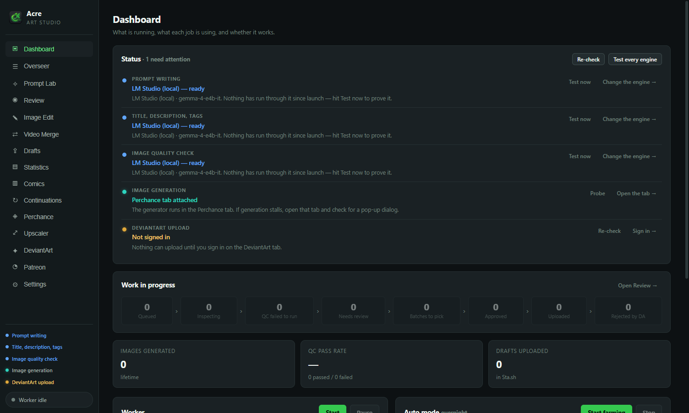
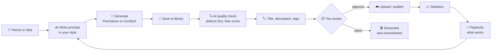
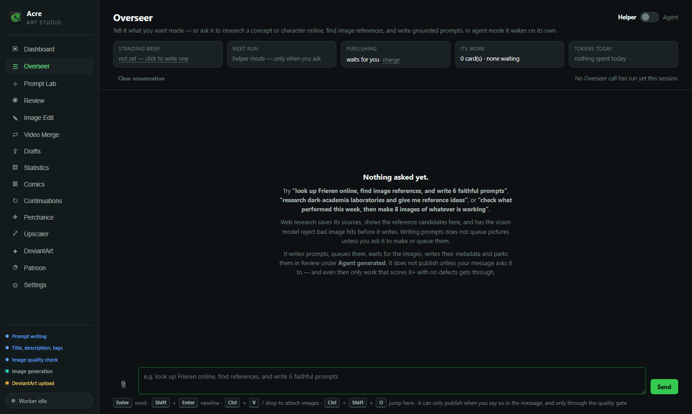
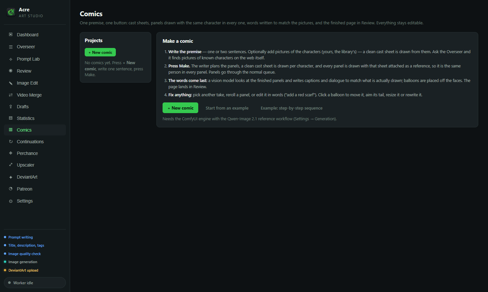
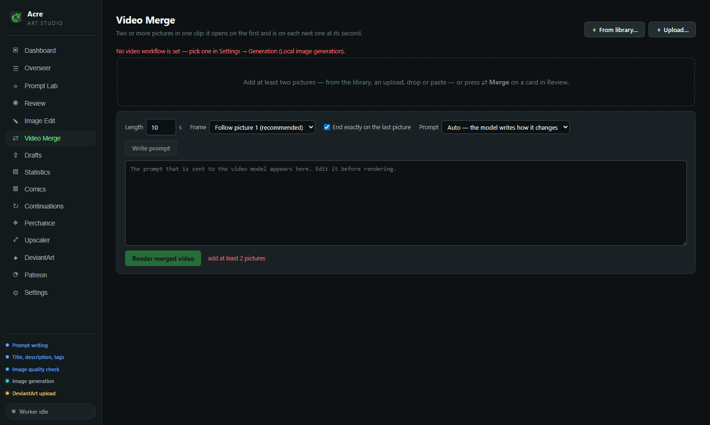
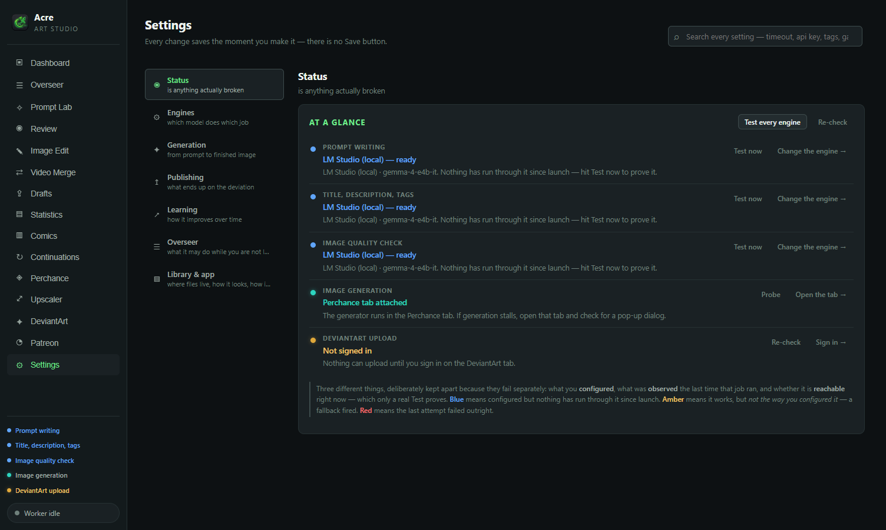
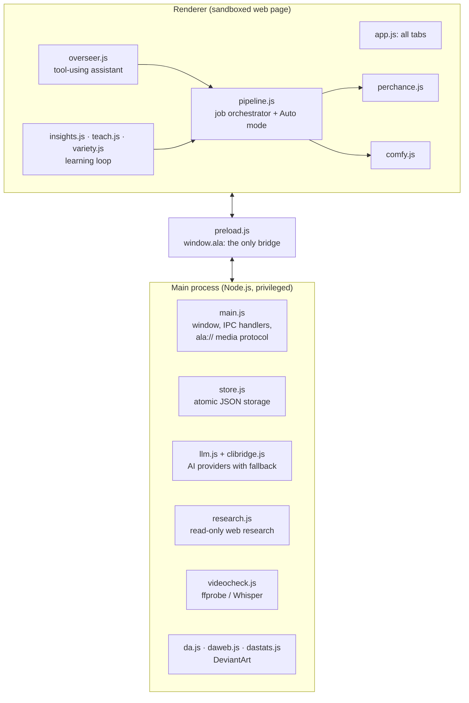

<div align="center">


# Acre Art Studio

**An AI art studio that runs on your own computer.**
You describe what you want to make. The app writes the prompts, generates the images,
checks every picture for mistakes, writes titles and descriptions, and lines everything
up for you to approve. Nothing goes out without you saying so.

[](LICENSE)




</div>

---

## Contents

- [What is it, in plain words?](#what-is-it-in-plain-words)
- [What it can do](#what-it-can-do)
- [The whole story: how a picture is made](#the-whole-story-how-a-picture-is-made)
- [Install and run](#install-and-run)
- [A tour of the app](#a-tour-of-the-app)
- [For code reviewers](#for-code-reviewers)
- [Project layout](#project-layout)
- [Testing](#testing)
- [FAQ and troubleshooting](#faq-and-troubleshooting)
- [License](#license)

---

## What is it, in plain words?

Making AI art sounds like one step ("type a sentence, get a picture"). In practice it's a
long chain of small, repetitive jobs. You write a good prompt, generate several versions,
and look closely at each one for broken hands or garbled text. Then you pick the best,
think of a title, write a description, choose tags, and upload it. After that you check how
it did and use that to decide what to make next.

**Acre Art Studio automates the boring parts of that chain and leaves the decisions to you.**

Think of it as a small studio team that lives inside one desktop app:

| Team member | What it does for you |
|---|---|
| ✍️ **Writer** | Turns a theme ("lighthouses in a storm") into several detailed image prompts, in *your* style |
| 🎨 **Illustrator** | Sends those prompts to an image generator, either the free Perchance website or ComfyUI on your own GPU |
| 🔍 **Quality inspector** | An AI that looks at every picture and scores it, listing defects like extra fingers, melted faces or broken text |
| 🏷️ **Editor** | Writes a fresh title, a description and search tags for each picture |
| 📋 **You, the art director** | See everything in one Review grid. Approve or reject with one key, edit any text |
| 📈 **Analyst** | Watches which published pieces people liked and feeds those lessons back to the Writer |
| 🤖 **Assistant (the Overseer)** | A chat you can talk to in plain English: *"research this character and make 6 pictures of it"* |

It works with **free, local AI** (e.g. [LM Studio](https://lmstudio.ai/) on your own PC)
and with paid online AI services. You choose per job, and if one engine fails the app
falls back to the next one on its own.

---

## What it can do

**Creating**
- 🧠 **Prompt Lab**: write new prompts from an example prompt, from a reference picture, from web research or from a short story
- 🖼️ **Two image engines**: Perchance (free, in-app browser, no GPU needed) or ComfyUI (local, any workflow you like, including video)
- 📐 **Image shape**: choose the shape of new ComfyUI pictures (square, 2:3 portrait, 16:9 and more); the workflow keeps its own pixel count
- 🎬 **Image to video**: turn an approved picture into a short clip, which the app then checks itself (length, sound, speech, what's on screen)
- 🎥 **A second video model**: an optional *fallback video model* (an LTX graph) for slower, more consistent clips, and for clips made from words alone, with no picture
- 🎞️ **Video Merge**: one clip that runs through two or more pictures, reaching each one at the second you choose
- ✏️ **Edit with words**: *"make the sky orange"* edits an existing picture. Attach reference pictures for the change, or ask for *"the character from image2"* and the character is redrawn in the picture's own style
- 📚 **Comics, webtoons and illustrated stories**: one premise, one button. The app plans the panels, draws a clean sheet per character and attaches it to every panel so the character stays the same person, keeps the best take of each panel, and writes the words to match what was actually drawn
- 🔁 **Continuations**: someone asked for "part 2"? It writes a sequel prompt that keeps the same character and outfit

**Checking**
- ✅ **AI quality check** that can only *lower* a score, never raise it (details [below](#design-decisions-worth-a-look))
- 🗂️ **Pick keepers**: see all versions of one prompt side by side and keep the clean one with a single key
- 🔤 **Title memory**: stops the AI from calling everything "Moonlit Serenity" by remembering every title it already used

**Publishing and learning**
- ☁️ Uploads to **DeviantArt** as private drafts (publishing is a separate, deliberate step)
- 📤 A **Patreon posting deck**: picture, title and text go to the clipboard in the order Patreon asks for them
- 📊 **Statistics and a learning loop**: which themes, tags and posting hours actually perform, turned into guidance for the next round. Every picture records which image model made it, so what works on one model is not taught to another
- 🧑‍🏫 **Teach it**: write your own rules ("always…", "never…") that the app follows and that no automatic rebuild can overwrite

**Running on its own (optional)**
- 🌙 **Auto mode** runs rounds unattended, with hourly limits and stop conditions, and parks every result in Review for you
- 🗣️ **Overseer in agent mode** wakes on a schedule, looks at what happened and works towards a goal you wrote down

---

## The whole story: how a picture is made



1. **An idea comes in.** You type a theme, pick an example prompt you like, drop in a
   reference image, or ask the Overseer in chat. In Auto mode the app picks a theme itself,
   based on what has worked before and what it hasn't tried lately.
2. **Prompts are written in your voice.** Image generators respond best to compact prompts
   (short comma-separated fragments, subject first). Most chat AIs write long paragraphs
   instead. The app shows the writer real examples of *your* prompts, then tidies the result
   in code. For variety it first extracts the **skeleton** of a good prompt (which slots it
   fills and in what order) and writes new prompts against that skeleton. You get new
   scenes in the same style, not the same words shuffled. For Qwen-Image the prompts are
   written as plain sentences instead, which that model follows better than tag lists.
3. **Images are generated.** Each prompt is rendered several times. While the GPU works on
   the next job, the previous batch is already being inspected, so the two never wait for
   each other.
4. **Every picture is inspected.** A vision AI must first *list what is wrong* (hands,
   faces, anatomy, text, artefacts) and only then give a score. Three extra checks in code
   can pull that score down: a general rating, a hard veto on structural defects, and a
   sharpness measurement taken on the pixels.
5. **Metadata is written.** Title, description and tags are written by an AI. A title that
   is too close to one already used is flagged, so a new one can be written.
6. **You decide.** The Review grid shows every picture with its score, defects, prompt and
   metadata, all editable. `J`/`K` move, `A` approves, `R` rejects, `U` uploads, and `P`
   opens *Pick keepers* to sort whole batches.
7. **Publishing.** Approved pictures upload to DeviantArt as private drafts. They are only
   published when you ask for it.
8. **Learning.** Views and favourites are read back and joined to the prompt that made
   each picture. The app works out what performs better than average, has an AI summarise
   that into short lessons, and hands the lessons to the prompt writer next round. Anything
   you **teach** it by hand always outranks what it measured.

---

## Install and run

### Requirements

| | |
|---|---|
| **Operating system** | Windows 10/11 (tested), macOS or Linux |
| **Node.js** | 18 or newer. The Windows installer sets it up for you if it's missing |
| **An AI for writing and checking** | Free and local: [LM Studio](https://lmstudio.ai/). The installer picks and downloads a model that fits your graphics card (table below). Or any OpenAI-compatible service with an API key |
| **An image engine** | Nothing extra for **Perchance** (built in). Optional: [ComfyUI](https://www.comfy.org/) for local generation and picture editing; the Windows installer sets it up for you |
| **Disk space** | About 1 GB for the app alone; 10-25 GB for an AI model; +20 GB for ComfyUI; +45 GB more for video |

### Windows (the easy way)

1. Click **Code → Download ZIP** on this page and unzip it anywhere, or
   `git clone https://github.com/PanPenek/AcreArtStudio-Showcase.git`
2. Double-click **`install.bat`**. It installs Node.js if needed and the app's single
   dependency (Electron, about 100 MB), then asks a few questions about AI models (below).
3. Double-click **`start.bat`**.

### What the installer asks

The installer first checks your graphics card and how much video memory (VRAM) it has. Then it
suggests the best choice for that card. Press Enter to accept it, type another number, or skip.

**1. The AI "brain"** (runs in LM Studio; writes prompts and titles, checks pictures, runs the Overseer):

| Your graphics card | Suggested model | Label | Download |
|---|---|---|---|
| none, or under 6 GB | Gemma 4 E4B | Fast-lightweight | 6.0 GB |
| 8 GB | Qwen3.5 9B | Balanced | 6.6 GB |
| 12 GB | Gemma 4 12B | Quality | 7.3 GB |
| 16 GB | Qwen3.8 27B, 3-bit (about 12 GB file) | High Quality (compact) | 13.0 GB |
| 24 GB or more | Qwen3.8 27B, Q4_K_XL | High Quality | 18.5 GB |

Every model gets a **64k-token context** by default. That is more than any job in the app
needs; you can change it in LM Studio. If LM Studio is missing, the installer offers to
install it. Small models work for titles and prompts, but the larger ones are much more
reliable at the Overseer's multi-step tool use.

**2. ComfyUI (optional, Windows).** Answer *no* and the studio uses the free Perchance
website. Answer *yes* and the installer downloads the portable ComfyUI and updates it to the
newest stable release. It then adds the GGUF loader node and installs this project's own
workflows (in `workflows/`), which the app already knows how to drive. Other workflows usually
need hand-editing to fit the app, so only these are installed. Image generation and editing
always use **Qwen-Image 2.1**:

| Choice | Label | VRAM | Download |
|---|---|---|---|
| Q8 | Quality | about 8 GB | 17.7 GB |
| Q4 | Balanced | about 4-5 GB | 14.2 GB |

`workflows/` also holds an optional **FLUX.3 Image Klein** graph (distilled int8, 16 steps,
ComfyUI 0.41 or newer). The installer does not download its models; the note inside the graph
lists the three files. Choose it as the generator workflow, or only for edits with the Image
Edit tab's *Workflow* menu. Reference pictures work on both engines: the app wires them to
whichever reference node the graph has.

**3. Video (optional).** Turns approved pictures into short clips with sound, using FastH3
(MiniMax H3 distilled to 4 steps). **It needs a graphics card with 16-24 GB of VRAM** and a
44 GB download, so the installer asks first and warns you.

A second video workflow can be added by hand in Settings → Generation → *Fallback video model*
(an LTX graph: slower, better consistency, and it can make a clip from text alone). When it is
set, Convert to video gets a *Video model* menu and the Overseer can use it with `model: "ltx"`.
The installer does not download it.

Every download resumes if it is interrupted and is checked against the file's published
SHA-256 before use, so running the installer again is always safe. At the end it saves
the choices into the app's settings, so the first start already uses them. Run it again at any
time with `npm run setup`; `npm run setup -- --dry-run` shows the plan without downloading anything.

### macOS / Linux

```bash
git clone https://github.com/PanPenek/AcreArtStudio-Showcase.git
cd AcreArtStudio-Showcase
./install.sh
npm start
```

### First five minutes

1. Start **LM Studio** and turn on its local server (Developer tab, default `http://localhost:1234`).
   The model the installer downloaded loads by itself on the first request.
2. In the app, open **Settings → Engines**. LM Studio is already set up with that model.
   Press **Test now** until the row turns green.
3. Go to **Prompt Lab**, type a theme (e.g. *"a lighthouse keeper's cat on a stormy night"*),
   press **Generate prompts**, then **Queue**.
4. Press **Start** under *Worker* on the Dashboard. Pictures appear in **Review** as they
   finish, already scored and titled.

No account is needed for any of this. DeviantArt, Patreon and pixiv are optional and only
matter if you want to publish.

---

## A tour of the app

| Tab | What you do there |
|---|---|
| **Dashboard** | Is everything working? One status row per job (writing, metadata, quality check, generation, upload), plus what's running right now |
| **Overseer** | Chat with the assistant. It can research a subject, write and queue prompts, edit pictures, make and merge videos, make comics and report back. Every action it takes is shown, so you can check what it did, and with a reasoning model its thinking is one click away (💭 Thought) |
| **Prompt Lab** | Write prompts from examples, reference images or a story. Manage the generation queue |
| **Review** | The main grid: every picture with its score, defects, prompt and metadata. Keyboard-driven. Every card has **✎ Edit** and **🩹 Fix** |
| **Image Edit** | Edit one picture with Qwen-Image 2.1: brush an area and say what should change there, or describe a change to the whole picture. Every result is a numbered checkpoint in a history panel (undo, redo with a new seed, reuse an instruction, branch from an older one). Results keep the source picture's size. A *Workflow* menu picks the edit engine (for example FLUX.3 Image Klein) without changing the generator's. 📎 attaches up to three reference pictures; *"make her the character from image2"* has a vision model describe that character and redraws it in the source picture's style |
| **Video Merge** | One clip through two or more pictures: set the second each picture is reached, let the model write how it changes (or write it yourself) and render it with the ComfyUI video workflow. The clip lands in Review as a new card |
| **Drafts** | What has been uploaded, what is waiting, what failed and why |
| **Statistics** | How published work performs, the learned playbook, and your own *Teach it* rules |
| **Comics** | Comic pages, webtoon strips and illustrated stories from one premise and one button. Pick another take, reroll or edit a panel in words, and drag, resize or rewrite balloons on the live page. Six page styles |
| **Continuations** | Turn "please make a part 2!" into a prompt that keeps the character |
| **Perchance / Upscaler / DeviantArt / Patreon** | Built-in browser tabs for those sites. You sign in once and the app reuses the session |
| **Settings** | One section at a time, with a search box that finds any setting. 9 colour themes |

**Sidebar order:** hold any tab for a second and drag it where you want it; the other tabs slide out of the way. Settings → Library & app → *Sidebar order* resets it. Right-click the Overseer tab → *Mark as read* clears its badge.

**Overseer engines:** a bar above the chat box shows the **Model** the Overseer runs on, its **Thinking** level, the **Vision** model that checks every picture, and a **Context** meter (the provider's own token count against the model's window, read from the server or typed in by clicking it). Click a chip to switch provider, model or thinking. The Overseer can do the same when you ask (`set_model`), and it can switch the ComfyUI workflow that renders, edits or animates (`set_workflow`, *"use FLUX"*).

**Reference pictures on a text-only model:** some image workflows only read text (MOSS-Image, for example). Jobs that carry reference pictures then render from the prompt alone by default, or on a *fallback workflow* that takes pictures when you say to use the picture as the input (Settings → Overseer; *Ask me* and *Always* are options too). Edits always need their picture: they render on the image workflow when it can edit, otherwise on the Image Edit workflow or the fallback. Tell the Overseer *"use the i1 reference"* and it works from that research picture only; a character that is not drawn as a human (a robot, a silhouette, a mask) keeps that form in every prompt.

**Make it yours:** Settings → Overseer → *Make it yours* holds your own instructions for the Overseer (personality, tone, standing rules). They are added to every turn; the upload gate still applies.

**Fixing broken pictures:** 🩹 Fix on a card repairs fingers, mushed detail, proportions, the face, or whatever QC found. When a vision model is available it first describes the *corrected* picture, which works much better than a list of defects. Local damage is repaired with an edit that keeps the look; a broken body gets a fresh render on new seeds with the same character, outfit and scene in a simpler pose. With *Auto-fix failed pictures* on (Settings → Generation), a picture that fails QC is repaired automatically, up to two tries. The Overseer can do the same on request ("fix the last batch").

<table>
<tr>
<td width="50%"><br><sub><b>Overseer</b>: talk to the app in plain English</sub></td>
<td width="50%"><br><sub><b>Comics</b>: one premise and one button to a finished, lettered page</sub></td>
</tr>
<tr>
<td width="50%"><br><sub><b>Video Merge</b>: one clip through two or more pictures</sub></td>
<td width="50%"><br><sub><b>Settings → Status</b>: configured, observed and reachable are three separate questions</sub></td>
</tr>
</table>

---

## For code reviewers

### Tech stack

- **Electron 37**: one desktop app for Windows, macOS and Linux
- **Plain JavaScript, no framework, no build step.** Every file you read is the file that runs.
  The UI is hand-written DOM plus one CSS file with theme tokens.
- **One runtime dependency (Electron).** HTTP, file I/O, image handling and the test harness
  all use what Node and Chromium already provide.
- **About 34,000 lines of JavaScript** in 48 modules (13 main-process, 35 UI), each opening
  with a header that explains its job, and **700+ doc comments** on functions

### Architecture at a glance



The UI never gets Node.js. It can only call the small, explicit API that
`preload.js` exposes (`contextIsolation: true`), so a bug in a web page shown inside the
app can't reach the file system. A full module-by-module map is in
**[docs/ARCHITECTURE.md](docs/ARCHITECTURE.md)**.

### Design decisions worth a look

| Decision | Why | Where |
|---|---|---|
| **The quality score can only go down** | A vision model asked "rate this 1–10" says 8 to almost everything. It must list defects *before* scoring, and three independent checks in code can lower the score but never raise it | `pipeline.js` |
| **Provider fallback chains per role** | Each job (writing, metadata, vision, assistant) has its own ordered list of AI engines. A refusal, rate limit or dead server moves on to the next one, and the UI shows which engine actually answered | `llm.js`, `providers.js` |
| **CLI tools as AI providers** | AI tools that are already signed in on the command line (Claude Code, Codex, Gemini CLI…) are used through stdin/stdout, with the same response shape as an HTTP API | `clibridge.js` |
| **"The workflow file is the config"** | Any ComfyUI graph works unchanged. On every job the driver traces the prompt node back from the sampler, randomises seeds and collects the outputs | `comfy.js` |
| **One JSON tool call per step** | The Overseer returns `{"say", "tool", "args", "done"}` instead of vendor function-calling, so small local models and CLI tools can drive it reliably | `overseer.js` |
| **Anti-collapse learning** | Always building on the best result makes every prompt the same scene. Overused phrases get banned for a round, examples rotate, and new creative axes are chosen by how *absent* they are | `variety.js` |
| **Human rules outrank measured ones** | Learned lessons are rebuilt from data. The artist's hand-written rules sit in a separate section that nothing automatic overwrites, and banned phrases are checked in code | `teach.js` |
| **Crash-safe storage** | Writes are debounced, then atomic (write a temp file, rename it over the original). A file that fails to load is quarantined, not overwritten with defaults | `store.js` |
| **Honest status** | Each engine reports *configured*, *observed* and *reachable* separately. A row is never green just because a setting is filled in | `health.js` |

### Data and privacy

- All data (settings, library, statistics) lives in the operating system's per-user app
  folder (`%APPDATA%\Acre Art Studio\` on Windows), **never in the project folder**.
  This repository contains no user data.
- API keys you enter stay on your machine in that folder. The repository ships with none.
- Web research is read-only, capped in size and type, and refuses private network addresses.

---

## Project layout

```
AcreArtStudio-Showcase/
├── install.bat / install.sh     one-click setup (Node.js + Electron, then tools/setup.mjs)
├── start.bat                    launch on Windows
├── package.json                 npm start · npm test
├── LICENSE                      GNU GPL v3.0
├── docs/
│   ├── ARCHITECTURE.md          module-by-module map for reviewers
│   └── screenshots/
├── workflows/                   ComfyUI graphs (Qwen-Image 2.1 Q8/Q4 and FastH3 video from the installer, optional FLUX.3 Klein)
├── tools/
│   ├── setup.mjs                model installer: VRAM detection, menus, verified downloads
│   ├── test.mjs                 offline unit tests (no Electron, no network)
│   └── *_test.mjs               offline suites for single features (Overseer tools, references, video)
└── src/
    ├── assets/                  app icon
    ├── main/                    Electron main process (privileged)
    │   ├── main.js              window, IPC, media protocol
    │   ├── preload.js           the UI ↔ main bridge
    │   ├── store.js             persistence + defaults for every setting
    │   ├── llm.js, clibridge.js AI providers
    │   ├── prompts.js           shared prompt templates
    │   ├── research.js          web research for the Overseer
    │   ├── videocheck.js        measure rendered videos
    │   └── da*.js, patreon-media.js   publishing helpers
    └── renderer/                the UI (sandboxed)
        ├── index.html, styles.css, app.js
        ├── pipeline.js          the orchestrator
        ├── perchance.js, comfy.js     image/video engines
        ├── overseer*.js         the assistant
        ├── promptlab.js, promptstyle.js, variety.js, titles.js
        ├── insights.js, teach.js, models.js, origins*.js   learning
        ├── comics*.js, comiclayout.js, continuations*.js
        ├── videomerge*.js       the Video Merge tab
        ├── fonts/               comic lettering fonts (SIL Open Font License)
        └── triage*.js, health.js, providers.js, …
```

---

## Testing

```bash
npm test
```

The tests load the **real** module files into an isolated Node VM (the way the browser
would run them) and check their behaviour directly. You don't need Electron, a network
connection, a GPU or an AI model to run them. They cover JSON recovery from messy AI
answers, the quality tail added to every prompt, prompt detection, title similarity, comic page geometry
and text wrapping, the parser for the AI's batch picks, the Video Merge timeline, which image
model made a picture, the character-remake prompt, tag clean-up for sentence prompts, reference
pictures on FLUX.3 Image Klein graphs, the Image Edit workflow menu and library pictures as
Overseer references. The feature suites next to it cover the image shape setting, text-only
workflows and the reference fallback, edit routing, named references, the Overseer engine bar
with `set_model`, and the fallback video model.

Every JavaScript file also passes `node --check`.

---

## FAQ and troubleshooting

**Do I need a powerful graphics card?**
No. The Perchance engine runs on the Perchance website inside the app. A GPU only matters
if you choose ComfyUI for fully local generation.

**Does it cost money?**
No. With LM Studio and Perchance everything is free. Paid AI services are optional.

**Will it post things without asking me?**
No. Uploads go to private drafts, and publishing needs its own explicit switch. The
Overseer can only publish when your message asks for it, and even then only pictures that
passed the quality check.

**A status row on the Dashboard is blue or red.**
Blue means "configured but not tested yet". Press **Test now**. Red means the last attempt
failed, and the row says why. The usual cause is that LM Studio's server isn't running.

**`npm install` finished but the app won't start.**
Newer npm versions can skip Electron's download step. This project allows it in
`package.json`. If you see *"Electron failed to install correctly"*, run
`npm rebuild electron`.

---

## License

Copyright © 2026 PanPenek

Acre Art Studio is free software, licensed under the
**GNU General Public License v3.0**. See [LICENSE](LICENSE).

In short:

- ✅ **Use it** for anything, including commercial work.
- ✅ **Modify it** and share your version.
- 🔓 **Keep it open.** If you distribute a modified version, you must release its full
  source code under the same GPL-3.0 license. Closed-source forks are not allowed.
- ✍️ **Give credit.** Keep the copyright notice and mark what you changed.

This summary is for convenience only. The [LICENSE](LICENSE) text is what applies.

Electron is © the Electron contributors (MIT). Perchance, ComfyUI, LM Studio, DeviantArt,
Patreon and pixiv are the property of their respective owners. This project isn't
affiliated with any of them.

The AI models the installer downloads are **not** part of this project and keep their own
licences, shown on each model's download page: Gemma 4, Qwen3.5 and Qwen3.8
(Apache-2.0), Qwen-Image 2.1 (Qwen Research License, non-commercial), MiniMax H3
(MiniMax H3 Community License). The optional FLUX.3 Image Klein graph uses models under the
FLUX Kommunity License. Check them before selling what you make.
